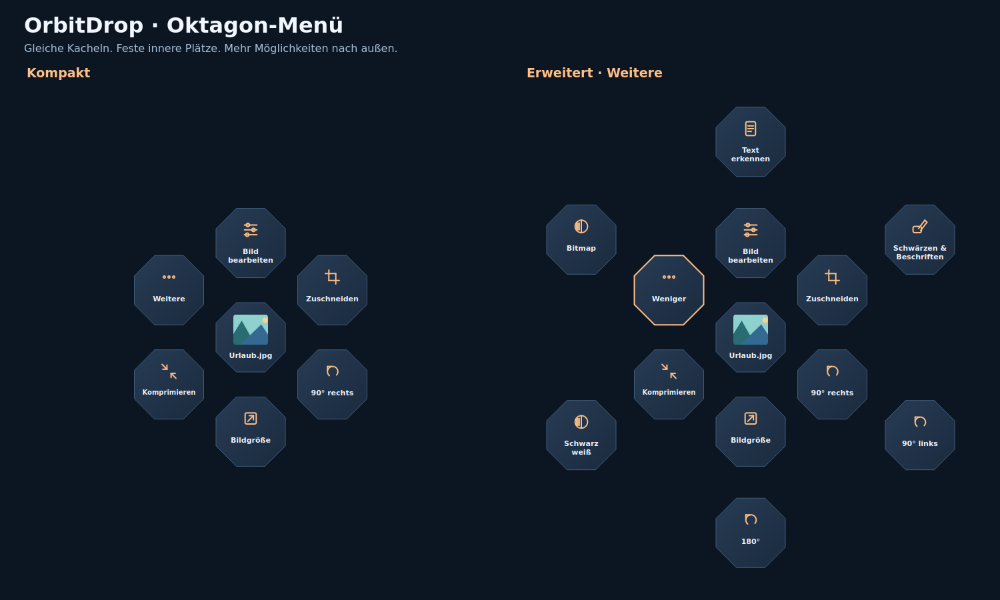
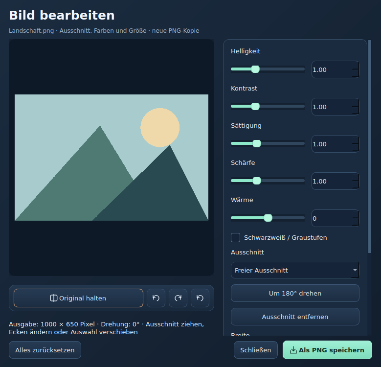
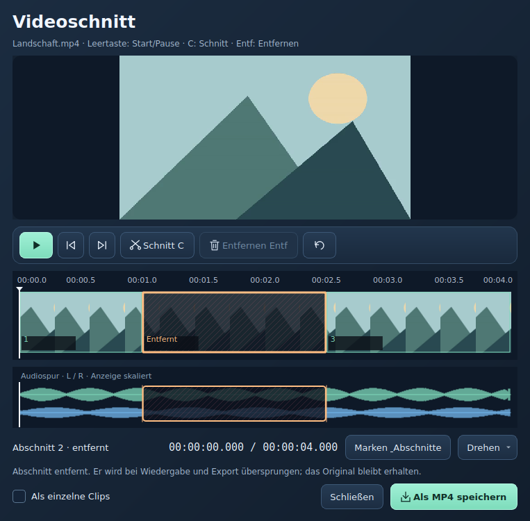

# OrbitDrop für Windows

**Dateien umwandeln, bearbeiten und organisieren – direkt dort, wo du sie gerade ziehst.**

OrbitDrop ist ein Windows-Dateiwerkzeug mit einem radialen Drag-and-drop-Menü. Ziehe eine Datei, tippe eine Taste an und lege sie auf der gewünschten Aktion im Kreis ab. Statt für jede kleine Aufgabe ein eigenes Programm zu öffnen, erreichst du Konverter, Bildeditor, Audio-/Videoschnitt, Downloads und Dateiaktionen über dieselbe Oberfläche.

OrbitDrop erkennt den Dateiinhalt und zeigt passende Aktionen für deine Auswahl. Du kannst mehrere Dateien gemeinsam verarbeiten, häufige Aktionen als Favoriten speichern und unbenutzte Menüpunkte ausblenden. Konvertierung, Bearbeitung und Texterkennung laufen lokal auf deinem Rechner.

  

*Aufnahme der aktuellen Programmoberfläche: Bearbeiten-Kreis für ein Bild. Je nach Datei und deinen Einstellungen erscheinen andere Aktionen.*

| Bereich | Standardtaste | Beispiele |
| --- | --- | --- |
| 🟢 Konvertieren | **Shift** | Bilder, Audio, Video, Dokumente und Untertitel umwandeln |
| 🟠 Bearbeiten | **Strg** | Schneiden, zuschneiden, drehen, komprimieren, Text erkennen |
| 🔵 Tools | **Alt** | ZIP, Ablage, Terminal, Umbenennen, Downloads und Einstellungen |

## Installation · Quick Install

**[Windows-Setup 0.27.0 herunterladen](https://github.com/Chaozz2go/OrbitDrop/releases/download/v0.27.0/OrbitDrop-0.27.0-Windows-x64-Setup.exe)** · **[Windows-Downloads & Releases](https://github.com/Chaozz2go/OrbitDrop/releases)** · **[Quellcode als ZIP](https://github.com/Chaozz2go/OrbitDrop/archive/refs/heads/main.zip)**

> **Aktuelle Windows-Version: 0.27.0.** Öffentlich veröffentlicht und unter Windows geprüft. Basis ist Version 0.20.0 mit unverändertem Radialmenü und neuem Dashboard. Bestehende Installationen erhalten 0.27.0 über die Updateprüfung.

### Windows-App ohne Python

So installierst oder aktualisierst du OrbitDrop:

1. [Releases öffnen](https://github.com/Chaozz2go/OrbitDrop/releases) und beim aktuellen Release **Assets** aufklappen.
2. **`OrbitDrop-<Version>-Windows-x64-Setup.exe`** herunterladen und starten.
3. Dem Setup folgen und **OrbitDrop** anschließend über das Windows-Startmenü öffnen. Die Installation erfolgt für dein Benutzerkonto und benötigt keine Administratorrechte.

**Ohne Installation:** Stattdessen `OrbitDrop-<Version>-Windows-x64-Portable.zip` herunterladen, vollständig entpacken und `OrbitDrop.exe` starten. Den gesamten entpackten Programmordner zusammenlassen.

Die Windows-Pakete enthalten Python, Qt, FFmpeg/FFprobe sowie deutsche und englische OCR-Sprachdaten. Unterstützt werden **Windows 10 ab Build 17763 und Windows 11, jeweils x64**. Die Programme sind bislang nicht digital signiert.

### Jetzt starten: Quellcode mit Python

1. **Python 3.12 x64** von [python.org](https://www.python.org/downloads/windows/) einschließlich des Python-Launchers (`py`) installieren.
2. [Quellcode-ZIP herunterladen](https://github.com/Chaozz2go/OrbitDrop/archive/refs/heads/main.zip) und vollständig in einen beschreibbaren Ordner entpacken.
3. Im Projektordner **`Start.cmd`** doppelklicken. Beim ersten Start installiert das Skript die Python-Abhängigkeiten; dafür ist eine Internetverbindung nötig.
4. Für Audio und Video zusätzlich **`Medien-einrichten.cmd`** ausführen. Es richtet FFmpeg und FFprobe ein. Fehlende OCR-Sprachdaten kannst du später unter **Text erkennen → Deutsch/Englisch einrichten** nachladen.

Nach dem Start findest du OrbitDrop im Windows-Infobereich neben der Uhr, gegebenenfalls unter dem kleinen Pfeil. Starte OrbitDrop wie den Explorer ohne erhöhte Administratorrechte, damit Drag-and-drop funktioniert.

### Zusätzliche Dokumentkonverter

Für manche Formate werden weitere Programme gebraucht. Installiere sie nur, wenn du die jeweilige Funktion nutzt, und starte OrbitDrop anschließend neu. **Alt → Konverter** zeigt, welche Programme gefunden wurden.

| Aufgabe | Benötigtes Programm |
| --- | --- |
| Audio-/Videokonvertierung und Schnitt | FFmpeg + FFprobe; im Windows-Paket enthalten, beim Quellstart über `Medien-einrichten.cmd` |
| Office-Dokumente, Tabellen, Präsentationen und deren PDF-Export | [LibreOffice](https://www.libreoffice.org/download/download-libreoffice/) |
| Bestimmte Umwandlungen zwischen DOCX, Markdown, TXT, EPUB und HTML | [Pandoc](https://pandoc.org/installing.html) |
| Unverschlüsselte RAR-Dateien entpacken | Externer Decoder wie unrar, unar oder bsdtar im PATH |

## Dashboard · Einstieg und Ersteinrichtung

Beim Start öffnet sich das Dashboard. Es bleibt offen, bis du es selbst schließt. Rechtsklick auf das OrbitDrop-Symbol neben der Windows-Uhr → **Dashboard** öffnet es wieder. Mit **Dashboard beim Start öffnen** kannst du den automatischen Start abschalten; OrbitDrop bleibt nach Schließen des Fensters im Tray aktiv.

- **Willkommen:** Kurzanleitung und deine Tastenbelegung. **Erst die Datei greifen und ziehen, dann die Bereichstaste drücken.**
- **Einrichtung:** verständliche Statusanzeige, Zweck der Programme, Prüfen, Einrichten, offizielle Downloadseiten und Fehlerdetails.
- **Anleitung:** lokal durchsuchbare Hilfe direkt im Dashboard.
- **Einstellungen:** Tasten, Menüpunkte, Qualität, Ordner, Autostart und Startverhalten anpassen und speichern.
- **Updates:** Version prüfen, Versionshinweise lesen, Updates herunterladen und installieren.
- **Verwaltung:** Verlauf, eigene Abläufe, Schnellaktionen, Downloader und Debugging öffnen.

Im Windows-Paket sind Python, Python-Pakete, FFmpeg/FFprobe und OCR-Sprachdaten bereits enthalten. LibreOffice und Pandoc sind optional für zusätzliche Dokumentformate. Deno, Node oder QuickJS ermöglicht das Lesen vieler YouTube-Player; „Einrichten“ installiert Deno. Die Prüfung lädt nichts herunter. **Einrichten** startet nur nach deinem Klick eine Installation: FFmpeg/OCR direkt, weitere Programme über den Windows-Paketmanager winget. Dabei gelten die Paket- und Quellenbedingungen; Windows kann Administratorrechte anfragen. Fehlt winget oder schlägt die Installation fehl, öffne die offizielle Downloadseite und prüfe danach erneut. Fortschritt, Abbruch und Fehler bleiben im Dashboard sichtbar.

Die Radialoptik entspricht Version 0.20.0. Beim Greifen einer Desktop-Datei wird das Fenster unter der Maus berücksichtigt, auch wenn vorher ein anderes Programm aktiv war. Im Alt-Menü entfallen Link einfügen, Anleitung, Debugging, Konverter und Kopieren. Das Tray enthält Dashboard, Audio/Video-Downloader, OrbitDrop pausieren und Beenden. Alle Verwaltungsfunktionen bleiben im Dashboard erreichbar, einschließlich Dateiablage, Werkzeuge und Tastenzugänge pausieren.

## Audio/Video-Downloader · Links und Warteschlange

Über **Tray → Audio/Video-Downloader** oder das Dashboard öffnest du die Download-Verwaltung. Mehrere Links links zeilenweise sammeln; einen Link auswählen und rechts prüfen. Audio/Video, Qualität, Speicherort und bei Playlists die gewünschten Titel festlegen, dann **zur Warteschlange hinzufügen**.

Unter **Warteschlange & Verlauf** kannst du Fortschritt ansehen, wartende Aufträge umsortieren, abbrechen, erneut einreihen und Ergebnisse oder Zielordner öffnen. Downloads laufen nacheinander. Pausieren stoppt das Starten weiterer Aufträge; Schließen des Fensters lässt sie weiterlaufen. Die Warteschlange gilt für die laufende Sitzung. Abgeschlossene Aufträge bleiben im gespeicherten Verlauf; die App startet nach einem Neustart keine alten Downloads automatisch. Ein Entfernen aus der Liste löscht keine heruntergeladenen Dateien.

## Anleitung

### 1. Das Kreismenü bedienen

1. Eine oder mehrere Dateien im Explorer mit der linken Maustaste ziehen.
2. Während des Ziehens **Shift** für Konvertieren, **Strg** für Bearbeiten oder **Alt** für Tools kurz drücken und wieder loslassen. Die Maustaste weiter gedrückt halten.
3. Die Datei kurz in die Kreismitte halten. OrbitDrop prüft die Auswahl und zeigt passende Aktionen an.
4. Auf das gewünschte Format oder Werkzeug ziehen und dort die Maustaste loslassen.
5. Falls ein Einstellungsfenster erscheint, die Vorschau prüfen und die Aktion starten. Fortschritt und Ergebnisse stehen unter **Aufträge**.

Du kannst während des Ziehens zwischen den drei Bereichen wechseln. Alternativ das Dashboard öffnen, unter Verwaltung den Aktionskreis öffnen und eine Datei hineinziehen. In der Startansicht wählst du zuerst Konvertieren, Bearbeiten oder Tools. **Esc** schließt den Kreis. **Zurück** führt zur Bereichsauswahl.

**Rechtsklick im Kreis** öffnet die Aktionssuche. Suche beispielsweise nach „schneiden“ oder „komprimieren“ und öffne die passende Aktion mit Enter. Über **Favorit setzen** stehen häufig genutzte Aktionen im jeweiligen Bereich zuerst und erhalten einen Stern.

Bei mehreren Dateien erscheinen nur gemeinsam passende Aktionen. Ein Bild und ein Video werden beispielsweise nicht automatisch zu einer gemeinsamen Datei verbunden. Die Dateiendung allein entscheidet nicht über die Erkennung; Inhalt und verfügbare Konverter werden ebenfalls geprüft.

### 2. Dateien konvertieren

**Dateien ziehen → Shift → Zielformat wählen.** Bei Bedarf Einstellungen und Ausgabeordner wählen, dann starten. Alle passenden sichtbaren Zielformate stehen im Kreis, bei vielen Einträgen in mehreren Ringen.

| Dateityp | Unterstützte Möglichkeiten |
| --- | --- |
| Bilder | JPG, PNG, WebP, HEIC, AVIF, TIFF und BMP umwandeln; Bilder als PDF speichern; Rasterbilder als SVG vektorisieren |
| SVG | SVG als Bild oder PDF ausgeben; die Eingabe wird dafür gerastert |
| Audio | MP3, M4A, WAV, FLAC, OGG, Opus, AIFF und WMA; konkrete Ziele hängen von verfügbaren FFmpeg-Encodern ab |
| Video | MP4, MOV, MKV, WebM, AVI, WMV und GIF; Audio aus Videos mit Ton extrahieren oder ein erstes Standbild speichern |
| PDF | Als JPG/PNG, DOCX, PPTX, XLSX, EPUB, TXT oder Markdown ausgeben |
| Dokumente und E-Books | DOCX, Markdown, TXT und EPUB; je nach Konverter auch RTF, DOC und HTML als Eingabe sowie PDF-Ausgabe |
| Präsentationen | PPT/PPTX als PDF oder Seitenbilder exportieren |
| Tabellen | XLSX, ODS, CSV und TSV umwandeln sowie als PDF ausgeben; XLS als zusätzliche Eingabe |
| Untertitel | SRT ↔ VTT oder Text ohne Zeitmarken als TXT speichern |
| Archive | ZIP, TAR und GZIP neu verpacken; RAR nur als Eingabe mit zusätzlichem Decoder |

Die Tabelle beschreibt die Formatfamilien. Nicht jede Kombination ist möglich; der Kreis zeigt die für deine konkrete Auswahl verfügbaren Ziele.

**Bei PDF und Office beachten:** PDF → DOCX extrahiert Text, statt das ursprüngliche Layout vollständig wiederherzustellen. PDF → PPTX setzt jede Seite als Bild auf eine Folie. PDF → XLSX benötigt erkennbare Tabellen. JPG/PNG-Exporte mehrseitiger PDFs werden als ZIP mit Seitenbildern gespeichert. Gescannte PDFs benötigen zuerst die separate Texterkennung. CSV/TSV übernehmen nur ein Tabellenblatt und erhalten keine Office-Formatierungen oder Formeln.

Normale Bildkonvertierungen sind für Einzelbilder ausgelegt; Animationen und mehrseitige Bilder werden dabei abgewiesen. JPG unterstützt keine Transparenz. Neuencodierung von Audio und Video kann Qualität kosten.

### 3. Bilder bearbeiten

**Ein Bild ziehen → Strg → Bild bearbeiten.** Im Editor kannst du den Ausschnitt mit der Maus festlegen, ein Seitenverhältnis wählen, das Bild drehen, die Ausgabegröße setzen und Helligkeit, Kontrast oder Farben anpassen. Vorschau, Originalvergleich und Zurücksetzen helfen beim Abstimmen. Export speichert eine neue Datei.

Weitere direkte Aktionen im Bearbeiten-Kreis:

| Aktion | So verwendest du sie |
| --- | --- |
| Zuschneiden | Ausschnitt mit der Maus aufziehen und bei Bedarf ein festes Seitenverhältnis verwenden |
| Bildgröße | Breite/Höhe in Pixeln einstellen; auch mehrere Einzelbilder gemeinsam verarbeiten |
| 90° links/rechts oder 180° | Bild direkt drehen |
| Schwarzweiß | Graustufen oder zwei Farben mit Vorschau erzeugen |
| Bitmap | Ein echtes 1-Bit-Bild erstellen; den Schwellwert mit dem Regler abstimmen |
| Schwärzen & Beschriften | Deckende Bereiche, Texte, Pfeile und Rahmen einzeichnen; Elemente verschieben oder rückgängig machen |

Beim Beschriften werden die Elemente fest in die neue Bilddatei gezeichnet. Es gibt keine automatische Erkennung vertraulicher Inhalte; kontrolliere die fertige Ausgabe.

### 4. Bilder als SVG vektorisieren

**Bild ziehen → Shift → SVG Schnell oder SVG Erweitert.**

- **SVG Schnell** bereitet das Bild automatisch vor und erzeugt Vektorpfade.
- **SVG Erweitert** öffnet eine Vorschau mit Reglern für Vorbereitung, Konturen/Farben und Glättung. Werte anpassen, Ergebnis prüfen und exportieren.

Für Logos, klare Linien und Stencils helfen saubere Kontraste und passende Schwellenwerte. Ein Foto wird dadurch nicht verlustfrei rekonstruiert; sehr viele Details können große SVG-Dateien mit vielen Pfaden erzeugen.

### 5. Video und Audio schneiden

**Eine Video- oder Audiodatei ziehen → Strg → Schneiden.** Videos zeigen einen Filmstreifen und eine Audiospur, Audiodateien eine Wellenform. Klicke die gewünschte Zeitposition an und setze Schnittmarken. Anschließend kannst du einzelne Abschnitte auswählen und aus der Ausgabe entfernen.

| Taste | Funktion im Schnittfenster |
| --- | --- |
| **Leertaste** | Abspielen / pausieren |
| **← / →** | Im Video ein Frame zurück / vor; im Audio um 0,1 Sekunden springen |
| **C** | Schnittmarke an der aktuellen Position setzen |
| **Entf** | Ausgewählten Abschnitt aus der Ausgabe entfernen |
| **Shift + Entf** | Ausgewählte Schnittmarke entfernen |
| **Strg + Z / Strg + Y** | Schnittänderung rückgängig machen / wiederholen |

Beispiel: Vor und nach einem unerwünschten Teil jeweils **C** drücken, den entstandenen Abschnitt anklicken und **Entf** drücken. Die Wiederherstellen-Schaltfläche nimmt einen ausgeschlossenen Abschnitt wieder auf.

Mit **100–1600 % Zoom**, horizontalem Scrollen und **Einpassen** navigierst du durch längere Dateien. Filmstreifen und Audiospur eines Videos bleiben zeitlich ausgerichtet. Videos lassen sich im Editor auch drehen. Beim Export werden die behaltenen Bereiche in einer neuen Datei verbunden; die Quelle bleibt erhalten.

### 6. Audio verbessern

**Audiodatei ziehen → Strg → Audio verbessern.**

1. Bei Bedarf Lautheit normalisieren und ein Ziel wie −16 oder −23 LUFS wählen.
2. Optional Stille am Anfang und Ende entfernen. Der Schwellwert-Regler legt fest, was als Stille zählt; innere Pausen bleiben erhalten.
3. Ein-/Ausblenden in Sekunden einstellen und als neue FLAC-, WAV- oder MP3-Datei ausgeben.

Zu hohe Stille-Schwellen können sehr leise Anfänge oder Enden abschneiden. Die Normalisierung misst in zwei Durchläufen; FFmpeg und FFprobe werden benötigt.

### 7. Dateigröße reduzieren

**Bild, PDF, Audio oder Video ziehen → Strg → Komprimieren.** Die aktuelle Größe wird sofort angezeigt, bei mehreren Dateien zusätzlich die Summe.

- Das gewünschte Limit mit dem Schieberegler oder genau über das MB-Feld einstellen. **0 MB** entfernt das Limit.
- Bei mehreren Dateien gilt dasselbe absolute Limit **für jede Datei**, nicht für den gesamten Stapel. Der Prozentregler orientiert sich an der ersten Datei.
- Bei Bildern zeigt eine berechnete Vorschau die Ergebnisgröße. Audio und Video werden auf technisch mögliche Bitraten geprüft; unerreichbare Ziele sperren den Export.
- Bei PDFs wird verlustfreie Optimierung geprüft. Das Größenlimit verändert dort nicht die PDF-Qualität und garantiert keine Einsparung.

Niedrige Audio-/Videobitraten können hörbare oder sichtbare Verluste erzeugen. Prüfe die fertige Datei. Wiederkehrende Einstellungen kannst du als **Schnellaktion** speichern; passende Rezepte erscheinen danach im Bearbeiten-Kreis.

### 8. PDF-Seiten verwalten und Text erkennen

**PDF ziehen → Strg → PDF-Seiten.** Die Seiten erscheinen als Vorschaubilder. Mit Strg/Shift mehrere auswählen, per Drag-and-drop oder Pfeilen umordnen, drehen, duplizieren oder entfernen. **Entf** entfernt Seiten, **Strg+Z** nimmt Änderungen zurück. Export erstellt eine neue PDF.

**PDF teilen** erzeugt einzelne Seiten. **PDFs verbinden** kombiniert mehrere PDFs; die Reihenfolge lässt sich vor dem Export einstellen.

**Bild oder PDF → Strg → Text erkennen:**

1. Deutsch, Englisch oder beide Sprachen und die Auflösung wählen.
2. Texterkennung starten. Fehlende Sprachdaten bei Bedarf über **Deutsch/Englisch einrichten** nachladen.
3. Erkannten Text prüfen, korrigieren, kopieren oder als TXT speichern.
4. Optional über **Scan-PDF erstellen** eine neue durchsuchbare PDF erzeugen.

Die Erkennung läuft lokal. Beim Erstellen einer Scan-PDF werden die Seiten neu gerendert; Formulare, Vektoren und interaktive Elemente bleiben in dieser Ausgabe nicht erhalten. Originale behalten. OCR unterstützt bis zu 500 PDF-Seiten und 50 Megapixel pro Bild/gerenderter Seite; verschlüsselte PDFs werden nicht unterstützt.

### 9. Audio, Videos und Playlists herunterladen

**Einen vollständigen http(s)-Link markieren → Shift drücken.** Alternativ den Link in den Kreis ziehen oder **Alt → Link einfügen** verwenden. Die Konvertieren-Taste kann eine markierte Textauswahl auch ohne Datei-Drag als Link übernehmen; es startet dabei kein automatischer Download.

1. **Audio laden** oder **Video laden** wählen.
2. Link prüfen und einen Ausgabeordner auswählen. OrbitDrop merkt sich den zuletzt verwendeten Downloadordner.
3. Bei Video bei Bedarf eine maximale Auflösung festlegen und den Download starten.

Audio wird als MP3 gespeichert. Getrennte Video-/Audiostreams werden als MKV kombiniert. Die verfügbaren Qualitäten hängen vom jeweiligen Dienst und Inhalt ab.

**Playlists:** Bei einem YouTube-Playlist-Link oder einem Videolink mit Playlist zeigt OrbitDrop eine Titelliste mit Auswahlkästchen. Alle verfügbaren Einträge sind zunächst markiert. Mit **Alle auswählen**, **Keine auswählen** oder einzelnen Häkchen entscheidest du, welche Titel geladen werden. Die Suche filtert nur die Anzeige; ausgeblendete markierte Titel bleiben ausgewählt.

Die ausgewählten Titel werden nacheinander geladen. Ein Fehler bei einem Titel stoppt die übrigen nicht. Beim Abbrechen bleiben fertige Dateien erhalten. Bereits als privat oder gelöscht erkannte Einträge sind nicht auswählbar; weitere Sperren können erst beim Laden auffallen. Es gibt keine automatische Anmeldung oder Übernahme von Browser-Cookies. Die Prüfung ist auf 10.000 Einträge und fünf Minuten begrenzt; Unterplaylists werden nicht automatisch erweitert.

Neue Downloads bringen die Auftragsansicht wieder nach vorn, auch wenn sie bereits geöffnet oder minimiert war. Anschließend kannst du heruntergeladene Dateien über **Strg → Schneiden** bearbeiten.

### 10. Datei-Tools, ZIP und Ablage

**Dateien oder Ordner ziehen → Alt → Werkzeug wählen.** Diese Dateiaktionen funktionieren auch bei unbekannten Dateitypen und gemischten Auswahlen.

| Werkzeug | Funktion |
| --- | --- |
| Pfad | Vollständige Pfade als Text kopieren |
| Explorer | Datei markieren oder zugehörigen Ordner öffnen |
| Terminal | Terminal im ausgewählten bzw. enthaltenden Ordner öffnen |
| Verschieben | Ziel wählen und Originaldateien dorthin verschieben |
| ZIP | Ausgewählte Dateien und Ordner gemeinsam in ein neues ZIP packen |
| Entpacken | Erkannte Archive in jeweils einen neuen Unterordner entpacken |
| Ablage | Dateien vorübergehend im schwebenden Fenster parken und später in andere Apps ziehen |
| Umbenennen | Mehrere Dateien mit Vorschau nach einem Muster umbenennen |

**Ablage:** Sie merkt sich Dateiverweise und kopiert oder verschiebt die Originale nicht. **Andocken** setzt das Fenster an den rechten Monitorrand. Leeren, Entf oder „Aus Ablage entfernen“ entfernen nur die Einträge. Die Ablage gilt für die laufende Sitzung; extern verschobene Dateien können ungültige Verweise hinterlassen.

**Archive:** Normale ZIPs benötigen keine zusätzliche Einrichtung. Auch TAR und GZIP werden unterstützt; RAR braucht einen externen Decoder. Keine Passwortarchive oder 7z. Beim Entpacken gelten maximal 2 GiB und 10.000 Einträge; problematische Pfade und Links werden abgewiesen. Bestehende Dateien werden nicht überschrieben, Archiv-Metadaten und NTFS-Rechte werden nicht vollständig übernommen.

**Stapel-Umbenennen:** Ein Muster wie `Urlaub_{n}` oder `{name}_{n}`, Startnummer und Ziffernzahl einstellen. Die Dateiendung bleibt erhalten. Vorher-/Nachher-Liste prüfen und **Wie angezeigt umbenennen** wählen. **Letzte Umbenennung zurücknehmen** funktioniert bis zum Schließen des Fensters, sofern die Dateien unverändert sind. Verschieben und Umbenennen ändern die Originale; kontrolliere deshalb das Ziel und die Vorschau.

### 11. Eigene Bildabläufe erstellen

**Alt → Bildabläufe.** Schritte hinzufügen, mit den Pfeilen ordnen und unter einem eigenen Namen speichern. Möglich sind Verkleinern, Drehen, Graustufen, Metadaten entfernen, Komprimierung, Formatwechsel und Ausgaben benennen.

Beispiel: **Längste Kante 1600 px → Metadaten entfernen → WebP → `Web_{n}`**.

Benennen gehört an das Ende. Gespeicherte Abläufe erscheinen für Bilder direkt im Bearbeiten-Kreis. Die Originale bleiben erhalten; nur fertige neue Ergebnisse werden ausgegeben. Diese Abläufe sind für Einzelbilder gedacht, nicht für Audio-/Videoketten.

### 12. Tasten und Menüs personalisieren

**Alt → Einstellungen** oder **Dashboard → Einstellungen**.

- **Allgemein:** Die drei Bereichstasten frei auf unterstützte Einzeltasten oder Kombinationen legen, etwa F8, Strg+E und F9. Taste eingeben oder im Aufnahmefeld drücken, anschließend speichern. **Standardtasten wiederherstellen** setzt Shift / Strg / Alt zurück.
- **Menüpunkte:** Formate, Bearbeitungen, Dateiaktionen, Programmfunktionen und eigene Abläufe per Checkbox ein-/ausblenden. Die Suche hilft beim Finden; Gruppen-Checkboxen schalten die gesamte Gruppe. SVG Schnell und SVG Erweitert sind einzeln steuerbar.
- **Weitere Einstellungen:** Ausgabeordner, Bild-/Videoqualität und optionalen Windows-Autostart festlegen. Ohne festen Ausgabeordner werden normale Konvertierungen neben der Quelle gespeichert. Downloads merken sich ihren eigenen zuletzt gewählten Ordner.

Mehrdeutige Belegungen wie Shift und Shift+F9 werden abgewiesen. Strg+Alt bleibt für AltGr reserviert; Esc, Win-Kombinationen und Alt+F4 sind nicht belegbar. Die ursprünglichen Windows-Funktionen gewählter Tasten bleiben aktiv. Die Tastatursteuerung innerhalb der Editoren wird dadurch nicht geändert.

**Spielschutz:** Automatische Datei-Tastenzugänge reagieren nur im Explorer, auf dem Desktop, in OrbitDrop und in unterstützten Dateimanagern (Total Commander, Double Commander, Directory Opus, FreeCommander und Files). In anderen Apps – auch Spielen im Fenstermodus – öffnet Shift/Strg/Alt plus Mausklick keinen automatischen Kreis. Dort kannst du den Kreis über Dashboard → Verwaltung → Aktionskreis öffnen und anschließend eine Datei hineinziehen. Markierte Links lassen sich ohne gedrückte Maustaste aus Edge, Chrome, Firefox, Brave, Vivaldi, Opera, LibreWolf, Waterfox und Floorp übernehmen; im Browser-Vollbild ist das gesperrt. Für Browser-Spiele kannst du zusätzlich im Dashboard unter Verwaltung **Tastenzugänge pausieren** aktivieren. Die Pause gilt bis zum erneuten Abschalten oder Programmneustart. Die manuelle Bedienung bleibt möglich.

Ausblendungen gelten im Kreis und in der Aktionssuche, auch für Favoriten. Falls du Einstellungen oder alle Menüpunkte ausgeblendet hast: **Rechtsklick auf das OrbitDrop-Symbol im Windows-Infobereich → Dashboard → Einstellungen → Alle Menüpunkte wieder anzeigen.** Änderungen gelten beim nächsten Öffnen des Kreises.

### 13. Aufträge, Fehler und Updates

**Alt → Aufträge** zeigt Fortschritt, fertige Ergebnisse und Fehler. Auftrag auswählen, **Ergebnis öffnen**, **Ordner anzeigen**, **Details** oder **Abbrechen** verwenden. **Verlauf leeren** entfernt nur Einträge, keine Ergebnisdateien.

Normale Konvertierungen und Bearbeitungen erstellen neue Dateien; vorhandene Namen erhalten Nummernzusätze. Bei Abbruch bleiben bereits fertige Konvertierungen oder Playlist-Titel erhalten. Mehrstufige Bildabläufe und manche Werkzeug-Stapel räumen ihre selbst erzeugten Teilergebnisse dagegen vollständig auf. Die Details nennen Fehler oder zu prüfende Pfade.

**Datei nicht erkannt?** Unter **Alt → Konverter** prüfen, ob benötigte Programme gefunden werden. Dateien aus Cloud- oder Netzlaufwerken gegebenenfalls erst vollständig lokal speichern. Nicht erkannte Typen erscheinen unter **Debugging** und können für die Fehlersuche exportiert werden. Vor dem Weitergeben persönliche Dateipfade und Fehlermeldungen prüfen.

**Dashboard → Updates** sucht nach veröffentlichten stabilen GitHub-Releases. Bei jedem Programmstart wird standardmäßig nach Updates gesucht. Das lässt sich unter **Einstellungen** oder **Updates** ausschalten. Bei bestehenden Installationen wird die neue Startprüfung einmalig aktiviert; eine anschließend gespeicherte Abwahl bleibt erhalten. Release-Entwürfe werden nicht angeboten. Download-Prüfsummen werden geprüft; die Installation startest du ausdrücklich, sobald keine Hintergrundaufträge mehr laufen.

Die vollständige Hilfe findest du jederzeit direkt im Programm unter **Dashboard → Anleitung**. Sie zeigt auch deine aktuelle Tastenbelegung.

---

OrbitDrop von Chaozz2go · [GNU AGPL v3](LICENSE) · [Hinweise zu Drittanbietern](THIRD-PARTY-NOTICES.md) · [Fehler melden oder Funktion vorschlagen](https://github.com/Chaozz2go/OrbitDrop/issues)

Dateiverarbeitung und OCR erfolgen lokal. Internet wird für gestartete Downloads, die Einrichtung zusätzlicher Komponenten und aktivierte Updateprüfungen verwendet. Es gibt keine eingebaute Telemetrie und keinen automatischen Upload deiner Dokumente.
