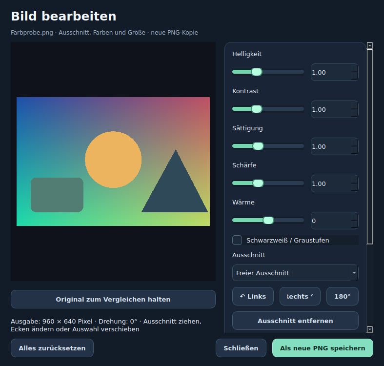
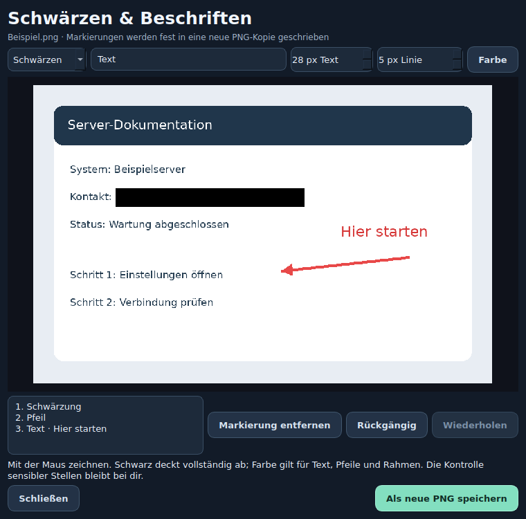

# OrbitDrop 0.12.0 – Windows-Prototyp

Lokaler Dateikonverter mit radialem Drag-and-drop-Menü, inspiriert vom Bedienkonzept von Tangerine. Eigenständiges Projekt ohne Verbindung zu Tangerine.

## Neu in Version 0.12.0: Komprimieren, Markieren und Schnellaktionen

**Shift = Konvertieren · Strg = Bearbeiten · Alt = Tools** bleibt unverändert.

### Komprimieren mit überprüfter Zielgröße

Datei(en) ziehen → **Strg → Komprimieren**. Für Bilder gibt es eine Vorher-/Nachher-Vorschau der ersten Datei, Qualität, längste Kante und WebP/JPG/PNG als Ausgabe. Die Größenanzeige stammt aus einer vollständigen Probekodierung, nicht aus einer Schätzung anhand des Vorschaubilds. Bei einer Auswahl wird jede Datei mit denselben Einstellungen einzeln verarbeitet; das Größenlimit gilt pro Datei.

- **Video:** neue MP4 mit H.264/AAC, optional reduzierter Höhe. Ein gesetztes Limit aktiviert zwei Videodurchläufe mit berechnetem Bitratenbudget. Videos ohne Ton sind möglich.
- **Audio:** neue MP3, einstellbare Bitrate. Mit Größenlimit wird eine passende niedrigere Bitrate gesucht.
- **PDF:** verlustfreie strukturelle Optimierung, keine Rasterisierung. Das Layout und auswählbarer Text bleiben erhalten; bei bereits optimierten PDFs kann die Ersparnis gering sein.
- **MB** bezeichnet 1.000.000 Byte. Übersteigt das fertige Ergebnis das Limit oder ist dieses unerreichbar, wird die neu angelegte Ausgabedatei entfernt und ein Fehler gemeldet. Ohne Limit ist eine Größenreduktion nicht garantiert. Das Limit eines großen Batches ist keine Grenze für dessen Gesamtgröße.
- **Transparenz:** WebP/PNG erhalten Alpha, JPG erhält einen weißen Hintergrund. Bilder werden vor der Verarbeitung anhand ihrer EXIF-Ausrichtung gedreht.

Originale werden nicht überschrieben. Ergebnisse landen neben der jeweiligen Quelldatei oder im eingestellten Ausgabeordner. Aufträge erscheinen im vorhandenen Verlauf und können abgebrochen werden. Bei Fehlern/Abbruch eines Komprimierungsstapels werden seine bereits erzeugten Ergebnisse ebenfalls entfernt. Video/Audio benötigen einen geeigneten FFmpeg-/FFprobe-Build mit den verwendeten Encodern.

### Schwärzen und Beschriften

Ein Bild ziehen → **Strg → Schwärzen & Beschriften**. Mit der Maus deckende schwarze Rechtecke, Pfeile oder Rahmen zeichnen; für Text eine Beschriftung eingeben und auf das Bild klicken. Farbe, Textgröße und Linienstärke gelten für neue Markierungen. **Verschieben** wählen und eine Markierung im Bild ziehen. Über die Liste lassen sich einzelne Markierungen entfernen. **Rückgängig/Wiederholen** bzw. Strg+Z/Strg+Y unterstützen die letzten 30 Schritte. Bis zu 200 Markierungen pro Bild.

Der Export schreibt alle Markierungen in die Pixel einer neuen PNG-Kopie. Schwarze Flächen sind vollständig deckend, auch bei transparenten Vorlagen. Der Export enthält keine Bearbeitungsebenen, eingebettete Originalansicht oder Original-EXIF. Schwärzungen werden manuell gewählt; automatische Gesichts-/Texterkennung und Video-Schwärzung sind noch nicht enthalten. Empfindliche Stellen im Ergebnis kontrollieren.

### Eigene Schnellaktionen

Im Komprimieren-Dialog einen Namen eingeben und **Einstellungen merken** wählen. Die passende Schnellaktion erscheint beim nächsten Öffnen direkt im **Bearbeiten-Kreis**; ein Klick startet einen Auftrag mit den gespeicherten Einstellungen. Derzeit sind das Komprimierungsrezepte, keine frei programmierbaren Makros. Bild-/Video-/Audio-/PDF-Rezepte werden nur beim passenden Dateityp angezeigt. Es werden keine Quelldateien oder Ausgabepfade im Rezept gespeichert; der aktuelle Ausgabeordner gilt weiterhin.

**Alt → Schnellaktionen** bietet die Verwaltung und **Startvorlagen hinzufügen**: Bilder fürs Web (WebP, max. 1600 px), Video 720p unter 20 MB und Audio klein (MP3, 96 kbit/s). Vorlagen werden nicht automatisch ungefragt in den Kreis gelegt. Schnellaktionen lassen sich entfernen; Namen müssen eindeutig sein. Bis zu 40 Rezepte werden dauerhaft in den Benutzereinstellungen gespeichert.

Dieser Ausbau ergänzt die drei zuerst gewählten Funktionsgruppen. Metadateneditor, Audio-Normalisierung, weitere Video-Werkzeuge und PDF-Seitenübersicht bleiben nächste Ausbauschritte; siehe [ROADMAP.md](ROADMAP.md).

## Änderungen in Version 0.11.1: Drei direkte Tastenzugänge

Datei im Explorer ziehen und eine Taste kurz antippen, dann wieder loslassen:

| Taste | Öffnet direkt | Beispiele |
| --- | --- | --- |
| **Shift** | **Konvertieren** | Passende Zielformate, SVG Schnell/Erweitert |
| **Strg** | **Bearbeiten** | Video-/Audioschnitt, Bildeditor, Crop, Drehen, PDF-Werkzeuge |
| **Alt** | **Tools** | Terminal, Dateiablage, Kopieren, Verschieben, ZIP, Entpacken, Explorer |

Die vorgelagerte Bereichsauswahl entfällt bei diesen Tastenzugängen. Beim Ziehen kann man zwischen den drei Bereichen wechseln. **Zurück** führt bei Bedarf zur Bereichsauswahl. Über das Infobereich-Symbol bleibt diese allgemeine Auswahl erreichbar. Bearbeiten und Konvertieren prüfen zuerst den Dateiinhalt; Tools funktioniert auch mit Ordnern und unbekannten Dateien ohne Medienkonverter.

Unter **Einstellungen** lassen sich alle drei Tasten zuordnen; sie müssen verschieden sein. Alte Einstellungen ohne separate Bearbeiten-Taste werden beim Laden auf Shift/Strg/Alt migriert. Ausgabeordner, ausgeblendete Formate und andere Einstellungen bleiben erhalten. Ein Strg+Alt-/AltGr-Akkord wird nicht als einzelner Tools-/Bearbeiten-Auslöser behandelt. Die normale Explorer-Wirkung der Modifikatortasten wird nicht global unterdrückt; die Taste vor dem Loslassen der Datei wieder freigeben.

Link markieren und Shift antippen öffnet weiterhin die Download-Auswahl. Ohne Ziehen lösen Strg und Alt keinen Kreis aus.

**Die nachfolgenden Versionsabschnitte enthalten die historischen Bedienabläufe; maßgeblich ist die obige Dreierbelegung.**

## Änderungen in Version 0.11.0

### Neuer Kreis: ruhige Flächen, klare Aktionen

Der erste Kreis bietet weiterhin **Konvertieren / Bearbeiten / Tools**. Alle Kreise verwenden abgerundete Segmente mit dunklen Flächen. Grün, Orange und Blau markieren die Bereiche und die jeweils aktive Aktion. Die Optionen haben eigene gezeichnete Vektorsymbole; die Erklärung unter dem Kreis beschreibt die gewählte Aktion. Bei mehr als zehn Optionen pro Gruppe entstehen zusätzliche konzentrische Ringe statt immer schmalerer Segmente. Alle Optionen bleiben gleichzeitig sichtbar. Ausblendbare Formate gelten weiterhin. Auf sehr kleinen Monitoren können umfangreiche Listen trotzdem eng werden.

### Ein Bildeditor für Ausschnitt, Farbe und Größe

**Bearbeiten → Bild bearbeiten** öffnet die große Vorschau mit seitlichen Reglern für Helligkeit, Kontrast, Sättigung, Schärfe und Wärme. Schwarzweiß/Graustufen ist zuschaltbar. **Original zum Vergleichen halten** zeigt das unbearbeitete Bild in seiner aktuellen Drehung, mit der gewählten Ausschnittmarkierung. Die Farbkorrektur wird für eine verkleinerte Vorschau im Hintergrund berechnet; gespeichert wird in voller Ausgabeauflösung. Schärfe kann in der verkleinerten Vorschau anders wirken als bei Betrachtung des Exports in voller Auflösung.

Ausschnitt direkt im Bild ziehen, an Ecken ändern oder verschieben. Freies Format, Quadrat, 16:9, 4:3 und 9:16 stehen zur Auswahl. Drehungen und Ausgabegröße liegen im selben Fenster. **Zuschneiden** sowie **Bildgröße** bei einer einzelnen Datei öffnen ebenfalls diesen Editor. Stapel-Bildgröße bleibt über das bisherige Werkzeug verfügbar. Bei der Größe bedeutet 0 / Automatisch die passende Originalkante; mit aktiviertem Seitenverhältnis sind zwei Werte ein Begrenzungsrahmen. **Alles zurücksetzen** stellt Farbe, Drehung, Ausschnitt und Größe wieder her.

Der Export speichert eine neue PNG-Datei neben dem Original bzw. im eingestellten Ausgabeordner. Transparenz bleibt erhalten; die Originaldatei wird nicht überschrieben. Animierte Bilder sind für diesen Editor nicht vorgesehen. Der Editor ist kein vollständiger professioneller Farbmanagement-/RAW-Workflow.

### Einheitliche Spezialdialoge

Schwarzweiß, 1-Bit-Bitmap und SVG nutzen dieselben Überschriften, Seitenflächen und primären Speicherbuttons. Original und Ergebnis stehen nebeneinander, die Regler rechts in einem scrollbaren Bereich. Schwellwertregler und SVG-Einstellungen bleiben erhalten.

Diese Version setzt den ersten Ausbau nach der Tangerine-Recherche um: Kreisgestaltung und Bildeditor. Beschriftungen, Collagen, Metadateneditor, Komprimierungsdialoge, zusätzliche Audio-/Videowerkzeuge, OCR und visuelle PDF-Seitenverwaltung sind noch nicht Teil dieses Schritts. Details stehen in [ROADMAP.md](ROADMAP.md).

## Änderungen in Version 0.10.1

### Zuerst Bereich wählen, dann alle passenden Optionen im Kreis

Datei ziehen → Shift antippen → im ersten Kreis **Konvertieren / Bearbeiten / Tools** wählen. Anschließend zeigt ein großer Kreis alle passenden Optionen des gewählten Bereichs gleichzeitig, ohne rechte Menüfläche und ohne WEITER-Seiten. Konvertieren zeigt die verfügbaren, eingeblendeten Zielformate einschließlich SVG Schnell/Erweitert. Bearbeiten zeigt Zuschneiden, Drehen und weitere passende Bild-/Audio-/Videofunktionen. Tools enthält Dateiwerkzeuge und Programmfunktionen. **Zurück** führt zur Bereichsauswahl; die Datei bleibt ausgewählt.

Grün steht für Konvertieren, Orange für Bearbeiten, Blau für Tools. Die Kreisgröße passt sich an die verfügbare Bildschirmfläche an. Bei vielen Formaten helfen die Einstellungen zum Ausblenden. Strg bleibt der direkte Dateiwerkzeug-Zugang; Links bieten Audio/Video direkt. Windows-DPI und Explorer-Drag-and-drop bitte am Windows-Gerät prüfen.

### Unbenutzte Zielformate ausblenden

**Einstellungen → Formate im Kreis**: Haken entfernen, Speichern. Die Auswahl gilt beim nächsten Öffnen für alle Dateitypen und bleibt nach Neustart erhalten. SVG ausblenden entfernt beide SVG-Varianten. Die eigentlichen Konverter werden nicht deinstalliert oder gesperrt; nur ihre Format-Einträge verschwinden aus dem Kreis. Bearbeitungen wie Bitmap bleiben unabhängig sichtbar. **Alle Formate anzeigen** setzt die Haken zurück; anschließend speichern. Eine gemischte Dateiauswahl bleibt nach dem eigentlichen Inhalt geprüft, auch wenn alle ihre Formate ausgeblendet wurden.

### Schieberegler und gemeinsamer Dialogstil

Bitmap-/Schwarzweiß- und SVG-Dialoge bieten für jeden numerischen Parameter Schieberegler plus synchronisiertes Zahlenfeld. Automatische Schwelle deaktiviert den manuellen Schwellenregler. Regleränderungen aktualisieren die Vorschau nach einer kurzen Pause; genaue Werte sind weiterhin eintippbar. Kontrast/Helligkeit und Vereinfachung unterstützen Nachkommastellen. Zurücksetzen setzt Regler und Felder gemeinsam zurück. Alle Qt-Dialoge verwenden den gemeinsamen dunklen Stil mit mintfarbenen Reglern, abgerundeten Flächen und deutlichen Hover-Zuständen; native Windows-Dateiauswahldialoge folgen weiterhin Windows.

## Änderungen in Version 0.9.0

### Neues Menü nach dem freigegebenen Mockup

Der native Qt-Kreis verwendet große Symbole, feste Farbverläufe (Grün/Orange/Blau) und vollständig lesbare Außenbeschriftungen. Auch die Beschriftungen sind klick-/dropfähig. Die Mitte zeigt bei einem Einzelbild bis 40 Megapixel eine Dateivorschau, sonst Dateiname/Typ. Untermenüs öffnen sich als Auswahlkarten rechts neben dem Kreis; SVG bietet zwei große Karten für Schnell/Erweitert. Klick auf einen anderen Farbbereich wechselt den Bereich. Esc schließt weiterhin. Die Seitennavigation über WEITER bleibt erhalten; besonders lange Formatlisten werden aufgeteilt. Die Umsetzung verwendet native Zeichenoperationen, keine generierten UI-Bilder. Die Bildschirmposition wird beim Öffnen/Größenwechsel auf den verfügbaren Monitorbereich begrenzt; Windows-DPI und native Explorer-Drags bitte weiterhin am Gerät prüfen.

### Downloads: Ordner merken und Fenster hervorholen

Der zuletzt für einen gestarteten Download gewählte Zielordner wird separat als `download_dir` in den Einstellungen gespeichert, auch nach Neustart. Dadurch bleibt der Konvertierungs-Ausgabeordner unverändert. Falls das letzte Ziel nicht mehr existiert, fällt der Dialog auf Downloads zurück. Der neue Downloaddialog gehört zur Auftragsansicht und bleibt darüber; minimierte Aufträge werden wiederhergestellt. Nach Start eines Downloads wird dessen neuer Eintrag ausgewählt und die Auftragsansicht aktiviert. Die Aktivierung wird über Qt angefordert; das genaue Windows-Fokusverhalten muss am Gerät geprüft werden.

### Graustufen, Schwarzweiß und Bitmap

Bild → **Bearbeiten → Schwarzweiß** öffnet einen Dialog mit Original-/Ergebnisvorschau. Standard ist Graustufen (8 Bit), alternativ echtes Schwarzweiß mit zwei Farben (1 Bit). Helligkeit, Kontrast, automatische/manuelle Schwelle, Glättung, Invertieren und Floyd–Steinberg-Rasterung sind einstellbar. Ausgabe als neue PNG-Datei. **Bearbeiten → Bitmap** öffnet denselben Ablauf mit 1-Bit-Ausgabe als BMP. Das bisherige **Konvertieren → BMP** bleibt ein normaler Rasterformat-Export; eine BMP-Datei allein bedeutet noch nicht Schwarzweiß. Mehrere Bilder können mit den Standardwerten im Stapel verarbeitet werden. Transparenz wird bei der Vorbereitung auf Weiß gelegt, EXIF-Orientierung beachtet. Originale bleiben erhalten.

### SVG vektorisieren: Schnell oder Erweitert

Bild → **Konvertieren → SVG** → **SVG Schnell** oder **SVG Erweitert**.

- Schnell erledigt die Zwischenstufen automatisch: Transparenz auf Weiß, Graustufen, automatische Schwarzweiß-Schwelle, kleine Flecken entfernen, weiche Vektorkonturen.
- Erweitert zeigt für ein Bild Original und echte Ergebnisvorschau. Bildmodus Schwarzweiß/Graustufen/Farbe, Schwellwert, Kontrast, Helligkeit, Glättung, Invertieren, Rasterung, Arbeitsauflösung, Fleckenfilter, Farbzahl, Konturvereinfachung und Kurvenform sind einstellbar. Bei Schwarzweiß gilt die Schwelle; bei Farbe/Graustufen die Farbzahl. Der Fleckenfilter und die Vereinfachung beeinflussen nur SVG. Rasterung erzeugt viele kleine Punkte; für Logos meist ausgeschaltet lassen.
- Ausgabe enthält echte SVG-Pfade, keine eingebettete Rasterdatei. Weißer Hintergrund optional, bei Schwarzweiß sonst transparent. Ursprüngliche Abmessungen bleiben über viewBox/Skalierung erhalten. Arbeitsauflösung standardmäßig längste Kante 1600 Pixel, maximal 2400; große Bilder werden für die Vektorisierung verkleinert. Rasterexport bleibt in Originalauflösung, maximal 80 Megapixel.
- Besonders geeignet für Logos, Silhouetten und Strichzeichnungen. Fotos werden vereinfacht; Detailverlust und andere Konturen sind möglich. Weißes/leeres Bild kann ein leeres SVG ergeben. Die Vorschau basiert auf den gleichen Verarbeitungsparametern wie der Export. Konvertierung erfolgt im Hintergrund; Abbrechen kann während eines laufenden nativen Trace-Aufrufs erst danach greifen.
- VTracer ist auf **1.0.0a4** festgelegt (Vorabversion mit Windows-ABI3-Wheel für Python 3.15); Start.cmd installiert die neue Abhängigkeit, keine manuelle Compilerinstallation. PyInstaller sammelt das Modul ein. Eingabe-SVG wird weiterhin über Qt gerastert; keine SVG-zu-SVG-Bearbeitung.

## Änderungen in Version 0.8.3

Download-Fix für Windows: Wird die Fortschrittsdatei beim Umbenennen vorübergehend gesperrt (WinError 5), läuft der Download weiter. Die letzte lesbare Fortschrittsanzeige bleibt bestehen und spätere Aktualisierungen versuchen es erneut. Fortschrittsmeldungen sind auf fünf pro Sekunde begrenzt und innerhalb des Workers synchronisiert. Schreibfehler der Fortschrittsanzeige werden abgefangen; tatsächliche Download-/Exportfehler werden weiterhin gemeldet. Keine Administratorrechte oder Änderungen am Virenschutz erforderlich.

## Änderungen in Version 0.8.2

Pandoc wird unter Windows zusätzlich in `%LOCALAPPDATA%/Pandoc`, `%LOCALAPPDATA%/Programs/Pandoc`, Program Files/Pandoc, WinGet-Paketordnern sowie üblichen Scoop-/Chocolatey-Zugängen gesucht. Außerdem wird der aktuelle Benutzer-/System-PATH aus der Windows-Registry gelesen: Eine Pandoc-Installation nach dem Start von OrbitDrop kann so über **Tools → Programm → Konverter** erneut erkannt werden. Der Prozess-PATH und der lokale bin-Ordner bleiben unterstützt. Keine Änderungen an PATH oder Registry. Nach erfolgreicher Prüfung die Datei erneut in den Kreis ziehen, damit ihre Formate neu geprüft werden.

## Änderungen in Version 0.8.1

**Installationsfix für Python 3.15 unter Windows:** Die benötigten yt-dlp-Zusatzpakete werden explizit installiert; das optionale Brotli-Paket entfällt. Damit wird der im Fehlerprotokoll beobachtete C++-Build von Brotli vermieden. yt-dlp und EJS sind auf die zusammengehörigen Versionen 2026.8.19 / 0.8.0 festgelegt. Keine Installation von Visual C++ Build Tools für diesen Fehler nötig. ZIP in einen neuen Ordner entpacken und Start.cmd ausführen. Ein bestehender Programmordner kann alternativ vollständig mit den neuen Quellen aktualisiert werden; Start.cmd bemerkt die geänderte requirements.txt und versucht die Installation erneut. Eigene Mediendateien unverändert lassen.

**Tools → Programm → Debugging** sammelt automatisch Dateien ohne verfügbare Konvertierung: unbekannte/unsupported Formate, Erkennungsfehler sowie fehlende Konverter oder Encoder. Eine gemischte Auswahl ohne gemeinsame Ausgabe wird nicht als unbekannt protokolliert, solange jede Datei einzeln erkannt wird. Die Erkennung läuft im Hintergrund; zusätzliche Codecdiagnose maximal 5 Sekunden pro Problemdatei.

Gespeichert werden Name (nur lokal), Endung, Größe, erkannter Typ/Containerhinweis, technische Codecwerte, Fehlergrund, System-/Bibliotheks-/Konverterversionen, Zeitpunkt und Anzahl gleicher Ereignisse. Keine Dateikopie, Rohbytes, Medien-Tags oder vollständigen Dateipfade. Maximal 100 Einträge; Wiederholungen werden zusammengefasst. Speicherung lokal im selben Benutzerordner wie Einstellungen (`diagnostics.json`), über Neustarts hinweg. Erfasst werden Dateien beim Prüfen im Shift-Kreis; der direkte Strg-Dateiaktionskreis prüft keine Formate.

**Diagnose exportieren** erzeugt eine JSON-Datei zum Anhängen im Chat. Dateinamen werden standardmäßig durch `Datei_1.ext` usw. ersetzt; Originalnamen sind auf ausdrückliches Anhaken möglich. Vorhandene Exportdateien werden nicht überschrieben. **Liste leeren** löscht nur Diagnoseeinträge, keine Originaldateien. Exportdaten können Hinweise auf das technische System enthalten; sie werden nur lokal gespeichert und nicht automatisch versendet.

Der Downloader verwendet bereits yt-dlp, ebenso wie die Android-App. Eine JavaScript-Laufzeit wie Deno/Node/QuickJS ist eine zusätzliche yt-dlp-Abhängigkeit für bestimmte Seiten, kein Ersatz für yt-dlp.

## Funktionen aus Version 0.8

### Drei feste Bereiche im Kreis

Datei(en) ziehen → **Shift** kurz antippen → in der Mitte prüfen lassen → auf einem Bereich loslassen → Untermenü anklicken. Das erste Menü hat immer dieselben drei Bereiche:

| Bereich | Farbe | Inhalt |
|---|---|---|
| Konvertieren | Grün | Alle für die gewählte Datei und vorhandenen Konverter verfügbaren Zielformate |
| Bearbeiten | Orange | Bilder zuschneiden, drehen, skalieren; Audio/Video schneiden; PDFs teilen/zusammenfügen |
| Tools | Blau | ZIP, Entpacken, Ablage, Kopieren, Verschieben, Pfad, Terminal, Explorer; Link einfügen; Programm |

Nicht passende Bearbeitungen werden ausgeblendet. Bei gemischten Dateien werden nur gemeinsame Konvertierungen angeboten. **Tools → Programm** öffnet Aufträge, Einstellungen, Konverterprüfung und Hilfe. **Strg** beim Ziehen bleibt als direkter Zugang zu Dateiaktionen erhalten. Zurück führt eine Ebene zurück; die Mitte zum Startmenü. Farben bleiben auch in Untermenüs gleich.

### Breite Videoschnittleiste

Die breite Leiste zeigt echte Vorschaubilder über die gesamte Quelldauer. **C** teilt an der aktuellen Position. Einen Abschnitt in der Leiste anklicken, dann **Abschnitt entfernen** drücken. Entfernte Teile erscheinen dunkel und werden bei Wiedergabe und Export übersprungen. **Wiederherstellen** holt den ausgewählten Teil zurück. Die Originaldatei bleibt unverändert. Die obere Zeitskala lässt sich zum Springen ziehen. Leertaste und Einzelbildschritte bleiben erhalten; **Entf** löscht weiterhin eine ausgewählte Schnittmarke (führt die Nachbarabschnitte zusammen), nicht den Abschnitt.

Die Leiste bleibt auf die Quellzeit bezogen, damit entfernte Teile wieder angeklickt werden können. Für die Vorschau werden 14 Bilder im Hintergrund geladen; bei langen Videos oder entfernten Schlüsselbildern kann dies dauern. Noch kein Zoom und keine Mehrspurbearbeitung.

### Audio bearbeiten

Audio → Bearbeiten → Schneiden öffnet Vorschau und Abschnittsauswahl mit C, Leertaste, Entf und Pfeiltasten (0,1 Sekunden). Abschnitte per Haken behalten, gemeinsam oder separat als MP3 exportieren. FFmpeg/FFprobe erforderlich. Audio besitzt keine Einzelbilder.

### Links herunterladen

- Vollständigen http(s)-Link als Text markieren und **Shift antippen**; ein Shift-Klick wird nach Loslassen der Maustaste ausgewertet. Wenn die Anwendung ihre Auswahl über Windows UI Automation bereitstellt, erscheinen **Audio laden** und **Video laden**. Die Zwischenablage wird dabei nicht verändert. Die Windows-Erkennung ist hier noch nicht auf einem echten Windows-PC getestet und funktioniert nicht in jeder Anwendung.
- Alternativ einen Link mit Shift in den Kreis ziehen oder **Tools → Link einfügen** öffnen. Dort kann man einen kopierten Link einfügen.
- Vor dem Download werden Titel und verfügbare Videoauflösungen geprüft. Audio wird MP3 (192 kbit/s), Video behält das verfügbare Format; getrennte Bild-/Tonspuren werden in MKV zusammengeführt. Nur ein einzelner Link, keine Playlists/Suche und kein zusätzlicher Schnitteditor.
- Downloadordner wählen. Fortschritt, Geschwindigkeit, Abbrechen und Ergebnisse stehen unter Aufträge. Originale/vorhandene Downloads werden nicht überschrieben. Teil-Downloads liegen temporär und werden bei Fehler/Abbruch entfernt.
- Nutzt wie die vorhandene Android-Downloader-App **yt-dlp + FFmpeg**; die Windows-Oberfläche ist neu implementiert, kein vollständiger Import der Android-App. yt-dlp und EJS werden mit den Python-Abhängigkeiten installiert. FFmpeg/FFprobe bitte über Tools → Programm → Konverter einrichten.
- YouTube benötigt zusätzlich eine unterstützte JavaScript-Laufzeit (Deno ab 2.3 oder Node ab 22, alternativ QuickJS). Eine vorhandene Installation wird in PATH/bin erkannt. Downloadlinks: https://deno.com/ und https://nodejs.org/. Keine automatische Installation der Laufzeit und kein Download externer Challenge-Skripte; EJS kommt aus dem installierten Python-Paket. Websites können Login, Regionen oder Downloads einschränken; kein DRM-Umgehen. Bei Seitenänderungen Python-Abhängigkeiten aktualisieren: `.venv\Scripts\python.exe -m pip install --upgrade yt-dlp yt-dlp-ejs`.
- Echte Downloads mit Audio-/Video-Fixtures über lokalen HTTP-Server getestet. Live-Downloads von YouTube und Windows-Linkerkennung sind noch nicht bestätigt.

## Funktionen aus Version 0.7

Datei ziehen → Shift antippen → zuerst **KONVERTIEREN**, **BEARBEITEN** oder **TOOLS** wählen. Die Auswahl richtet sich nach der Datei. Untermenüs bleiben nach dem Loslassen offen und lassen sich anklicken; erneutes Ziehen ist nicht nötig. **DATEIEN** bietet ZIP, Entpacken und weitere Dateiaktionen. **Tools → Programm** öffnet Aufträge, Einstellungen, Konverterprüfung, Werkzeuge und Hilfe direkt aus dem Kreis.

### Videos schneiden

Video → Bearbeiten → Schneiden wählen. Im Videoschnitteditor gelten:

| Taste | Aktion |
|---|---|
| Leertaste | Wiedergabe starten / pausieren |
| Pfeil links / rechts | Ein tatsächliches Videobild zurück / vor |
| C | Schnittmarke an der aktuellen Position setzen |
| Entf | Ausgewählte Schnittmarke löschen |

Die Teilstücke in der Liste lassen sich per Häkchen behalten oder ausschließen. Beim Löschen einer Marke werden benachbarte Abschnitte zusammengeführt; bei gemischter Auswahl anschließend die Häkchen prüfen. Export verbindet behaltene Abschnitte oder schreibt auf Wunsch separate Clips. Drehung links/rechts/180° ist direkt im Editor möglich. Ausgabe ist ein neu encodiertes MP4 mit den Videoeinstellungen der App; FFmpeg und FFprobe werden benötigt. Frame-Navigation verwendet PyAV und tatsächliche Zeitstempel, auch bei variabler Bildrate. Wiedergabe und Ton hängen vom verfügbaren Qt-Medienbackend ab; Windows-Wiedergabe und Audio sind noch nicht auf einem Windows-PC geprüft.

### Bilder zuschneiden und drehen

Bild → Bearbeiten → Zuschneiden wählen. Rahmen ziehen, verschieben oder an den Ecken verändern; freie Auswahl oder 1:1, 16:9 und 4:3. Links/rechts/180° drehen ist direkt möglich. **DREHEN** im Kreis bietet außerdem die schnelle Drehung ohne Editor. Bearbeitete Bilder werden als neue PNGs gespeichert. Originale bleiben erhalten.

## Funktionen aus Version 0.6

| Funktion | Bedienung |
|---|---|
| Aufträge und Fortschritt | Öffnet sich bei einer Konvertierung oder Archivaktion. Videos/Audio verwenden die Zeitangaben von FFmpeg, ZIP-Erstellung verarbeitete Bytes, PDFs je nach Aktion Seiten. Bei unbekanntem Fortschritt läuft eine Aktivitätsanzeige statt erfundener Prozentwerte. |
| Abbrechen | Auftrag auswählen → Abbrechen. Laufende Konverterprozesse werden beendet, Bibliotheksaufrufe am nächsten geeigneten Verarbeitungsschritt gestoppt. Unfertige, von dieser Aktion erstellte Ausgaben werden nach Möglichkeit entfernt. Bereits fertige Konvertierungen im Stapel bleiben erhalten. |
| Ergebnisse öffnen | Auftrag auswählen → Ergebnis öffnen oder Ordner anzeigen. Bei mehreren Ausgaben erscheint eine Auswahl. |
| Verlauf | Letzte 50 abgeschlossene Aufträge inklusive Ausgabepfaden, Status und Fehlern, auch nach Neustart verfügbar. „Verlauf leeren“ löscht nur diese Liste, keine Ergebnisse. |
| Einstellungen | Rechtsklick auf Infobereich-Symbol → Einstellungen: Ausgabeordner, Bildqualität, Videoqualität/-größe, Tasten und optionaler Windows-Autostart. Änderungen gelten für neue Aufträge. |
| Konverterprüfung | Optional automatisch beim Start. „Konverter prüfen / einrichten“ prüft FFmpeg, FFprobe, Pandoc und LibreOffice. Medien-Setup startet direkt als Auftrag mit Fortschritt; Office/Pandoc-Schaltflächen öffnen die Downloadseiten. |
| Nur eine Instanz | Zweiter Start öffnet die vorhandene Auftragsansicht. Wenn das System lokale IPC blockiert, verhindert die Sperre dennoch einen Doppelstart; nur das Hervorholen kann dann ausfallen. |
| Zusätzliche Werkzeuge | Infobereich-Menü → „Werkzeuge: Bilder / PDF / Video“. |

### Neue Werkzeuge

- **Bildgröße ändern:** Breite/Höhe in Pixeln, 0 für automatische Kante, optional Seitenverhältnis beibehalten. Ergebnis ist PNG, maximal 80 Megapixel. Auch mehrere Einzelbilder.
- **Bild drehen:** 90°, 180° oder 270°, Ergebnis PNG, Original bleibt erhalten.
- **PDFs zusammenfügen:** mehrere PDFs auswählen und mit ↑/↓ in die gewünschte Reihenfolge bringen. Ergebnis ist ein neues PDF.
- **PDF aufteilen:** alle oder ausgewählte Seiten (z. B. `1-3,5`), pro Seite eine neue PDF-Datei. Keine OCR, keine verschlüsselten PDFs.
- **Video kürzen:** genau ein Video; öffnet den visuellen Schnitteditor. Neues MP4 durch Neuencodierung; nutzt Videoqualität und Größenlimit aus den Einstellungen. FFmpeg/FFprobe erforderlich.

Werkzeug-Aufträge bewahren Originale. Scheitert ein solcher Werkzeug-Stapel oder wird er abgebrochen, werden seine neu erzeugten Teilergebnisse entfernt. Bereits vorhandene Dateien werden nicht ersetzt. Konvertierungs-Stapel außerhalb der Werkzeuge behalten dagegen schon fertiggestellte Dateien.

### Einstellungen und Speicherung

Einstellungen/Verlauf werden pro Benutzer im von Qt vorgesehenen AppLocalDataLocation-Ordner gespeichert (unter Windows typischerweise `%LOCALAPPDATA%/OrbitDrop`). Sie bleiben bei einem neuen entpackten Programmordner erhalten. Die Historie speichert lokale Pfade und Fehlermeldungen, keine Dateiinhalte. Autostart wird ausschließlich auf ausdrückliches Anhaken über den Run-Eintrag des aktuellen Windows-Benutzers gesetzt. Nach Verschieben der Installation muss der Autostart-Pfad neu gespeichert werden.

- Leerer Ausgabeordner = neben der Quelldatei. Ein eingestellter Ordner muss existieren. ZIP-/Entpack-Ziele und Verschiebeziele werden weiterhin direkt gewählt.
- Bildqualität gilt für JPG, WebP, HEIC und AVIF; verlustfreie PNGs verwenden diesen Qualitätsregler nicht.
- Videoqualität und maximale Höhe gelten für MP4/MOV/MKV/WebM sowie MP4-Clips. Kleinere Videos werden durch das Höhenlimit nicht vergrößert. AVI/WMV/GIF behalten ihre bisherigen Vorgaben.
- Tasten: Shift, Strg oder Alt; die drei Bereiche müssen unterschiedliche Tasten haben. Beim Ziehen antippen und wieder loslassen.
- Bei Beenden mit laufenden Aufträgen werden Abbrüche angefordert; die App beendet sich nach Abschluss dieser Abbrüche. Lange Bibliotheks-/Netzwerkaufrufe können den Abbruch verzögern. Beim Verschieben können bereits abgeschlossene Bewegungen nicht automatisch zurückgenommen werden.

## Start unter Windows

1. ZIP komplett in einen beschreibbaren Ordner entpacken.
2. Python 3.10 oder neuer installieren: https://www.python.org/downloads/windows/
3. `Start.cmd` starten. Beim ersten Start installiert das Skript die Python-Abhängigkeiten aus PyPI. Bei Änderungen an requirements.txt werden sie erneut geprüft. Dafür ist Internet nötig; die Konvertierung erfolgt lokal.
4. Das grüne OrbitDrop-Symbol erscheint neben der Uhr, eventuell unter dem Pfeil. Das Konsolenfenster bleibt für Fehler sichtbar.

## Bedienung

1. Datei(en) im Explorer mit linker Maustaste ziehen.
2. **Shift** für Konvertieren, **Strg** für Bearbeiten oder **Alt** für Tools kurz antippen und wieder loslassen.
3. Datei kurz in der Kreismitte halten. Die App prüft den Inhalt im Hintergrund und blendet passende Aktionen ein.
4. Direkt auf das gewünschte Format, eine Bearbeitung oder ein Werkzeug im Kreis ziehen und loslassen. Während der Prüfung ist noch keine Aktion auswählbar.
5. Für einen übersichtlicheren Kreis ungenutzte Zielformate unter **Einstellungen → Formate im Kreis** ausblenden. Alle verbleibenden Optionen sind ohne Seitennavigation sichtbar.

Alternativ das grüne Symbol anklicken, danach eine Datei in den bereits geöffneten Kreis ziehen. Esc schließt den Kreis. Rechtsklick auf das Symbol bietet Anleitung und Beenden.

Mehrere Dateien: Nur gemeinsame Aktionen werden angeboten. Beispiel Video mit Ton + WAV → gemeinsame Audioformate. Bild + Video → keine gemeinsame Konvertierung. Bild + PDF kann gemeinsame Bild-/Textcontainer-Ziele haben, wird jedoch pro Datei separat verarbeitet. Es findet kein Zusammenfügen statt.

Bei Konvertierungen bleiben Originale erhalten. Ausgaben liegen daneben als `Name_converted.ext`; vorhandene Namen erhalten eine zusätzliche Nummer und werden nicht überschrieben. Fehlerhafte Ausgaben werden entfernt.

## Dateiaktionen (Alt)

Datei oder Ordner ziehen → Alt kurz antippen → auf eine Aktion loslassen. Dieser Kreis benötigt keine Medienkonverter und funktioniert auch mit unbekannten Dateiformaten und gemischten Auswahlen. Während eines Drags lässt sich mit Shift/Strg/Alt zwischen den Bereichen wechseln.

| Aktion | Verhalten |
|---|---|
| ZIP | Einzelne oder mehrere Dateien und ganze Ordner zusammen als ZIP speichern. Ziel und Dateiname werden gewählt; keine Überschreibung bestehender ZIPs. |
| ENTPACKEN | Erscheint bei erkannten Archiven. Zielordner wählen; jedes Archiv wird in einen neuen Unterordner `Name_entpackt` (ggf. nummeriert) entpackt. Originalarchive bleiben erhalten. |
| ABLAGE | Schwebendes Fenster, immer im Vordergrund. Merkt sich Originalpfade, ohne Dateien zu kopieren oder zu verschieben. Einträge auswählen und in andere Apps ziehen (Kopieraktion). Mehrfachauswahl möglich. |
| KOPIEREN | Dateien/Ordner in die Windows-Zwischenablage legen. Danach im Explorer mit Strg+V einfügen. |
| VERSCHIEBEN | Zielordner auswählen, dann Originale dorthin verschieben. Namenskonflikte werden vorab geprüft; es wird nicht überschrieben. Keine Aktion bei Abbruch des Zielordnerdialogs. |
| PFAD | Vollständige Pfade als Text kopieren, ein Pfad pro Zeile. |
| TERMINAL | Windows Terminal im Ordner öffnen; bei Dateien im enthaltenden Ordner. Fallback: PowerShell. Bei mehreren Ordnern ein Fenster je Ordner. Es wird kein Befehl aus dem Dateinamen ausgeführt. |
| EXPLORER | Einzelne Datei im Explorer markieren, Ordner öffnen. Bei mehreren Einträgen die beteiligten Ordner jeweils einmal öffnen. |

AirDrop wird nicht angeboten; ebenso kein automatisches Teilen/Versenden. Stattdessen gibt es die Explorer-Aktion.

Ablage über das Infobereich-Menü erneut öffnen. „Andocken“ setzt das Fenster an den rechten Rand des Monitors an der Mausposition. Es lässt sich auch normal verschieben. „Leeren“, Entf und „Aus Ablage entfernen“ löschen ausschließlich Verweise, keine Dateien. Die Ablage ist nur für die laufende Sitzung; nach Beenden der App ist sie leer. Werden Originale extern verschoben oder gelöscht, können Verweise ungültig werden.

Beim Verschieben wird nach einem Fehler gestoppt. Bereits erfolgreich verschobene Einträge werden nicht automatisch zurückverschoben. Laufwerksübergreifendes Verschieben von Ordnern kann Kopieren und anschließendes Entfernen der Quelle erfordern. Bei Kopier-/Löschfehlern können Original und (teilweise) Ziel gleichzeitig vorhanden sein; die Meldung fordert dann zur Prüfung auf. Beim Fallback werden spezielle Dateisystemmetadaten/NTFS-Rechte nicht vollständig garantiert.

## Zippen und Entpacken

- Dateien/Ordner markieren und ziehen → **Alt** antippen → **ZIP** → Namen/Speicherort wählen. Mehrere Quellen werden gemeinsam verpackt; ein mit ausgewählter Elternordner deckt seine Kinder bereits ab. Leere Ordner werden mitgenommen.
- ZIP ziehen → **Alt** → **ENTPACKEN** → Zielordner wählen. Mehrere Archive sind möglich; je Archiv entsteht ein eigener neuer Ordner. Die Aktion ist bei langen Menüs ggf. auf der nächsten Seite (kurz auf WEITER halten).
- Auch TAR, TAR.GZ und reines GZIP werden entpackt. RAR braucht zusätzlich das RAR-Python-Modul und einen externen Decoder (unrar/unar/bsdtar); dieser Weg ist weiterhin nicht mit echten RAR-Dateien getestet. 7z und Passwortarchive sind nicht implementiert.
- Keine Zusatzinstallation zum Erstellen/Entpacken normaler ZIPs. Verknüpfungen/Junctions und problematische Archivpfade werden abgelehnt; beim Entpacken gelten 2 GiB und 10000 Einträge. Fehlgeschlagene neue Entpackordner werden entfernt. Beim Zippen maximal 10000 Einträge; größere ZIPs können das Entpacklimit überschreiten.
- Archiv-Metadaten/NTFS-Rechte werden nicht vollständig übernommen. Vorhandene Dateien werden weder beim Zippen noch beim Entpacken ersetzt; bei einem Konflikt muss ein anderer ZIP-Name gewählt werden oder der Entpackordner erhält eine Nummer.

## MP4 wird nicht erkannt?

Im bisherigen Paket 0.3 waren FFmpeg/FFprobe nicht enthalten. Deshalb konnten Videos trotz MP4-Endung als unbekannt erscheinen. Das heißt nicht automatisch, dass das Video defekt ist.

1. OrbitDrop über das Infobereich-Menü beenden.
2. **Medien-einrichten.cmd** doppelklicken. Es lädt einen Windows-x64-Essentials-Build von gyan.dev (einem auf ffmpeg.org verlinkten Anbieter), prüft dessen veröffentlichte SHA-256-Prüfsumme und legt ffmpeg.exe/ffprobe.exe lokal in `bin` ab. Internet und Python werden für diesen explizit gestarteten Download benötigt; keine Administratorrechte und keine globale PATH-Änderung.
3. **Start.cmd** erneut starten und die MP4 mit Shift testen.
4. Falls weiterhin keine Aktionen erscheinen: Rechtsklick aufs Infobereich-Symbol → **Medienkonverter prüfen**. Dort stehen gefundene Pfade und Versionen. Dateien aus OneDrive/Netzlaufwerken ggf. zuerst vollständig auf die lokale Platte kopieren.

Das Downloadskript wurde auf Paketvalidierung/Prüfsummen/Dateiauswahl getestet, aber noch nicht auf Windows mit einem echten Download ausgeführt. Alternativ die beiden EXEs manuell über https://ffmpeg.org/download.html#build-windows beziehen und nach `bin` kopieren. Unter Windows ARM/32-Bit benötigt man passende eigene Builds.

Version 0.4 erkennt übliche MP4/MOV-Container auch ohne installierten Konverter und meldet dann „Medienkonverter fehlt“. Für tatsächliche Stream-Erkennung/Konvertierung bleibt FFprobe/FFmpeg notwendig. Wenn der Konverter vorhanden ist, werden dessen Dateifehler angezeigt, statt sie nur als „unbekannt“ zu verbergen. Übliche Program-Files-/WinGet-Installationen werden zusätzlich zum PATH gesucht.

## Formate und lokale Zusatzprogramme

Die App bietet nur Aktionen an, für die ein Backend gefunden wurde. Python-Bibliotheken installiert Start.cmd. Die folgenden eigenständigen Programme sind NICHT im ZIP enthalten:

| Bereich | Zusatzprogramm | Einrichtung |
|---|---|---|
| Audio/Video | FFmpeg + FFprobe | **Medien-einrichten.cmd** oder Windows-Build über https://ffmpeg.org/download.html#build-windows ; beide EXEs in `bin` ablegen oder in PATH installieren |
| Office/Tabellen/Präsentationen/PDF-Export von Dokumenten | LibreOffice | https://www.libreoffice.org/download/download-libreoffice/ ; normale Windows-Installation wird unter Program Files gefunden, alternativ soffice im PATH |
| DOCX/Markdown/TXT/EPUB/HTML untereinander | Pandoc | https://pandoc.org/installing.html ; pandoc.exe in `bin` oder PATH |
| RAR lesen | unrar, unar oder bsdtar | Im PATH verfügbar machen. Nur unverschlüsselte RAR-Dateien; noch kein Gerätetest mit RAR |

Ein Neustart von OrbitDrop nach Installation der Backends ist empfohlen.

## Abgleich mit der Formatliste

| Kategorie | Eingabe / Ausgabe | Umsetzung und Grenzen |
|---|---|---|
| Bilder | JPG, PNG, WebP, HEIC, TIFF, AVIF, BMP → dieselben Formate plus PDF | Pillow + HEIF-Plugin. Nur ein Einzelbild; mehrseitige TIFF/HEIF und APNG nicht unterstützt. JPG/BMP/PDF erhalten bei Transparenz weißen Hintergrund. HDR/Farbraum/Metadaten werden nicht originalgetreu garantiert. |
| SVG | SVG → Bildformate/PDF | SVG-Eingabe: Rasterung über Qt. Keine Skripte, eingebetteten Bilder oder externen Referenzen. Rasterbilder können als SVG vektorisiert werden; Eingabe-SVG wird nur gerastert. |
| Audio | MP3, M4A, WAV, FLAC, OGG, Opus, AIFF, WMA | FFprobe prüft echte Audiostreams; verfügbare FFmpeg-Encoder bestimmen die Ausgabeaktionen. Neuencodierung kann Qualität reduzieren. |
| Video | MP4, MOV, MKV, WebM, AVI, WMV, GIF | FFmpeg. Audioexport nur bei vorhandenem Audiostream. Erstes Standbild als eigene Aktion. GIF-Ausgabe: 12 FPS, 480 Pixel Breite; kein Ton. Video nimmt den ersten echten Videostream und optional die erste Audiospur. |
| PDF | PDF → DOCX, PPTX, XLSX, JPG, PNG, EPUB, TXT, MD | Keine OCR und keine vollständige Rekonstruktion des ursprünglichen Office-Dokuments. Details unten. **Keine Pages-Ausgabe.** |
| Dokumente | DOCX, Markdown, TXT, EPUB; RTF/DOC/HTML als weitere Eingaben | Pandoc bzw. LibreOffice abhängig von Richtung. DOCX/MD/TXT/EPUB/HTML über Pandoc übertragen Text/Struktur, Bilder werden als [Bild] ersetzt; externe Ressourcen und Roh-HTML werden nicht übernommen. PDF-Export über LibreOffice. |
| Apple Pages | Experimenteller Import über LibreOffice bei erkannten .pages-IWA-Paketen | Kompatibilität hängt von Dateiversion/LibreOffice ab. Kein Export und keine Garantie für erfolgreiche Konvertierung. Nicht in den Integrationstests abgedeckt. |
| Präsentationen | PPT/PPTX → PDF/JPG/PNG | LibreOffice. JPG/PNG: alle Seiten als ZIP. PPT nur Eingabe. PDF → PPTX siehe unten. |
| Tabellen | XLSX, ODS, CSV, TSV untereinander + PDF | LibreOffice. XLS nur Eingabe. CSV/TSV sind ein einzelnes Tabellenblatt, ohne Formeln/Formatierung/weitere Blätter; entsprechende Verluste sind möglich. CSV mit Komma/Semikolon, Textdateien aktuell UTF-8. |
| Untertitel | SRT ↔ VTT, jeweils → TXT | Zeitmarken und Text; erweiterte VTT-Formatierung, Styles/Regionen und Cue-Positionierung werden nicht vollständig übernommen. TXT enthält Text ohne Zeitmarken. |
| Archive | ZIP/TAR/GZIP untereinander; RAR nur Eingabe | Inhalt wird in einem temporären Ordner geprüft und neu verpackt. GZIP-Ausgabe ist TAR.GZ, weil GZIP selbst nur einen Datenstrom speichert. Reines GZIP als Eingabe ebenfalls möglich. Keine Passwortarchive. |
| macOS-Sonderformate | RTFD und Text Clippings | Noch nicht unterstützt. RTF-Dateien werden über LibreOffice verarbeitet. |

### PDF-Export ist je nach Ziel unterschiedlich

- **JPG/PNG:** alle Seiten mit 300 DPI in einer ZIP-Datei, zum Beispiel `Name_converted.png.zip`.
- **PPTX:** jede PDF-Seite wird als Bild auf eine Folie gesetzt. Optik bleibt weitgehend erhalten, die einzelnen Texte/Objekte sind nicht editierbar. Das Seitenverhältnis richtet sich nach der ersten Seite.
- **DOCX:** extrahierter Text mit Seitenumbrüchen. Kein originalgetreues Layout, keine Bildrekonstruktion.
- **XLSX:** erkannte Tabellen, je Tabelle ein Blatt. Ohne erkennbare Tabellen wird mit einer verständlichen Meldung abgebrochen.
- **TXT/MD/EPUB:** extrahierter Text; MD ist in dieser Version Text ohne rekonstruierte Markdown-Struktur. Leere/gescannte PDFs melden fehlenden Text statt einer vermeintlich erfolgreichen OCR.

### Archivgrenzen

Maximal 2 GiB entpackte Daten und 10.000 Dateien. Keine Links/Geräte, keine Pfade außerhalb des Archivs, keine unter Windows reservierten Namen. Leere Ordner, Dateirechte und besondere Archivmetadaten werden beim Neuverpacken nicht bewahrt. Der Vorgang kann temporär entsprechenden freien Speicher benötigen.

## Erkennung und Teststatus

Bilder werden mit Pillow geöffnet, Office/EPUB/ODS über ihre Paketstruktur erkannt, PDFs und Archive über Inhalt/Signaturen, Audio/Video über FFprobe geprüft. Reine Textformate haben keine eindeutige Signatur: Dort werden UTF-8, Struktur und ergänzend die Endung verwendet. Ein bloß zu .mp4 umbenanntes PNG wird als Bild erkannt. Nicht alle defekten/ungewöhnlichen Dateien sind schon bei der Vorprüfung erkennbar; der eigentliche Konverter kann sie anschließend noch ablehnen.

Automatische Windows-Einblendung: Shift/Strg/Alt + linke Maustaste werden global abgefragt; ein echter Explorer-Drag lässt sich damit allein noch nicht sicher nachweisen. Der Kreis kann deshalb auch bei anderen Ziehbewegungen erscheinen. Konvertierungen akzeptieren lokale Dateien; Dateiaktionen zusätzlich Ordner. Der native Drop wird immer als Kopieraktion angenommen; eine explizit gewählte Verschiebeaktion führt anschließend den getrennten Vorgang aus.

**Unter Linux geprüft:** Bildkonvertierung inklusive HEIC/AVIF, echte Audio-/Videodateien, PDF-Exporte, Office-/Tabellen-/Präsentationskonvertierung, EPUB/Pandoc, Untertitel, Archive, Originalschutz, gemischte Aktionen, Qt-Menü mit Seitennavigation, Dateiaktions-Menü/Ordnerannahme, Ablage-Verweise und Verschiebe-Fallback inklusive Namenskonflikten/Kopierfehlern. Windows-spezifische Aufrufe sind nur teilweise über Mocks geprüft.

**Noch unter Windows zu prüfen:** globaler Shift-Auslöser, OLE-Drop-Ziel beim laufenden Explorer-Drag, mehrere Monitore/DPI-Skalierung, konkrete Windows-Builds der Zusatzprogramme, native Explorer-Zwischenablage, Terminal-/Explorer-Aufrufe, MoveFileEx-API, Medien-Setup und EXE-Paket. Beide Programme ohne Administratorrechte starten. Keine fertige Windows-EXE liegt bei.

## EXE unter Windows bauen

`Build-EXE.cmd` erstellt standardmäßig ein **Ordnerpaket** unter `dist/OrbitDrop`. Den gesamten Ordner inklusive `_internal` weitergeben; darin startet OrbitDrop.exe ohne separat installiertes Python. Zum Bauen selbst werden Python, Internet für die Build-Abhängigkeiten und eine passende Windows-x64-Umgebung benötigt.

`Build-Einzeldatei.cmd` erstellt alternativ eine einzelne EXE mit PyInstaller. Ein Ordnerpaket ist für die ersten Gerätetests leichter zu prüfen. Beide Wege enthalten Versionsangaben und sammeln HEIF/PDF-Abhängigkeiten mit ein. Sie sind hier nicht unter Windows ausgeführt worden; es liegt keine fertig gebaute Windows-EXE bei.

FFmpeg/FFprobe aus `bin` werden eingebunden, wenn beide vorhanden sind. Das Medien-Setup aus der App kann beide Konverter später auch in einem `bin`-Ordner neben der EXE ablegen; dieser hat Vorrang vor eingebundenen Versionen. Der Installationsordner muss dafür beschreibbar sein. Pandoc/LibreOffice bleiben externe Zusatzprogramme. Keine Signatur und kein Installer enthalten.

## Entwicklertests

`python -m pip install -r requirements-dev.txt`

`python -m unittest discover -s tests -v`

Office-/Pandoc-/FFmpeg-Tests benötigen die entsprechenden installierten Programme. Qt-Oberflächentests laufen mit einer Offscreen-Oberfläche und ersetzen keinen Windows-Gerätetest. UI-Vorschau: `python orbitdrop.py --preview`.
